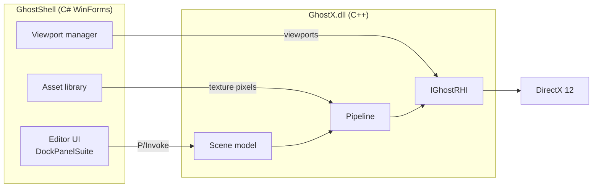

<div align="center">

## Game on Wayne!

# 👻 GhostX Version X 👻💡🧊💡👻

**DirectX12 RHI Renderer Engine Winforms Blazor WASM UI with a Visual Studio Docking Suite Editor**


</div>

GhostX is a custom renderer engine built on a **native C++ DirectX 12 renderer (RHI-style)** with a **C# WinForms editor shell** and a Blazor WASM UI.

## Notes:
- **Working: X64/Release/Debug --- Working: anyCPU Release ---Not working: anyCPU Debug cant find DLL**
- **If you use this app and the Dock Suite Doesn't show correctly Please delete the XML file in %LocalAppData%\GhostX and your app will run correctly.**
- **When importing FBX meshes please set Largest Side fit to 2 for default normal scaled import.**
- **If You want to Open the Entire Engine For editing Through the Game Engine You must download And Build it in Visual Studio**
- **Works in Play Mode/Standalone Window For One Level Game**(Test Phase Assimilated 12.C.)
## Development:
- (Test Phase 12.D.)** Two Level Game Does generate Packaged Folder with exe**
- **Does Not Have Standalone Install Shield Wizard Setup Package Yet**
- **Does Not Have Standalone Install Wizard for Built Games only Generate Files.**
---
## Definate Errors:
- **FLAWLESS VICTORY**
## Possible Encountered Errors:
- **Projects Not loading Scenes sometimes?**
- **Imported Textures Not showing on Content Broswer**
- **Not All Roles are Working as expected yet**
## Capacity
- **To Be filled**
- **One million vertices Scene Limit**
- **2048 Max Scene Objects**
## Requirements
- 4 Mhz DOS OS Computer with OnBoard GPU
---
## Roadmap
- **Featured/Assimilated**
- [x] Phase 1: Lighting, viewport icons, click/drag, editor panels
- [x] Phase 2: Textures and materials, Free Camera entities
- [x] Phase 3: Dockable editor, live camera viewports, per-camera resolution
- [x] Phase 4: Project Save/Load/ Load in VS/ Load Game Template/ Basic UI/Play Mode Only/ Object Roles / .ghostproject files / .ghostscene files / Orbit Camera
- [x] Phase 5: UI Editor Designer/ Text And 2D Layer /Widgets/ .ghostui files and the runtime
- [x] Phase 6: Sky Sphere / Custom Mods /Drop and Drag/ Cubemap with 47 Parameters and custom layers
- [x] Phase 7.A: Sprite Sheet Editor Creator / Square
- [x] Phase 7.B: Sprite Sheet Animation Editor / .ghostanim files
- [x] Phase 8: PBR Materials Layout
- [x] Phase 9: Object Shadows
- [x] Phase 10: AnyCPU/X64 Debug/Release Builds/Docking Suite XML Delete to Clear
- [x] Phase 11.A: FBX Imports as Default Color Import. Must Be Set to 2 For Sit Largest Side TO Default for Default Import(2 should be the auto default not 0?)
- [x] Phase 11.B: Saving models, the Models palette and Content Browser tiles.
- [x] Phase 11.C: Materials, collider fit, re-import.
- [x] Phase 12.A: Pre-Building Prep, Scene switching 
- [x] Phase 12.B: Pre-Building Prep, The standalone exe
- [x] Phase 13.A: Viewport tools, grid, gizmos and dimensions
- [x] Phase 13.B: Drag gizmos (translate, rotate, scale), axis constraints, grid snapping.
- [x] Phase 13.C: Click a dimension to type a new size, edge selection, units in Details.
- [x] Phase 14: Viewport Added to Window Dropdown if Docking Suite Fails/ Added Post Build Event GhostGame.dll copy to X64 Release Folder
- [x] Phase 15: Test/ Fix/ Add/ Quality Control 
- [x] Phase 15.A: Added Save as, Save, Set Startup Scene/Trace Stack Error For New Project open Project/ Requires Furrther Debugging
- [x] Phase 15.B: Max Caps Per scene Increased / Play Calls Scene
- [x] Phase 12.C: Level 1 Build and Test Play / Instructions/ ASSIMILIATION SUCCESSFUL....
- [x] Phase 15.C: Advanced Object Roles
- [x] Phase 15.E: 2D Animation States Push to Phase 16
- [x] Phase 15.G: Restore Function: Projects New/Load from 15.A /Removed var hint fixed Constructor In GhostContentBrowser.cs
- [x] Phase 15.F: Controls: Ctrl in Editor removed for down, Q/E/Space added for Up and Down
- [x] Phase 16: Sprite Animation State Editor Phases
- [x] Phase 19: Advanced Pre-Built Primitives List
- [x] Phase 15.D: Skysphere add full Display without horizon cutoff toggle
- [x] Phase 21: Per Clip textures for Animation States
- [x] Phase 12.E: Add UI For PlayTest On Level 1, HUD, enemies, Collision, Animation States
- [x] Phase Critical Errors Restore: Launches in Play Mode StandAlone Window, parse Updated
- **Active Core**
- [ ] Phase 12.F: Build The Rest of Level 1, Test Goal Proceed to 12.D test Scene Switch/ Roles are not working yet/ Camera/ test enemies
- [ ] Phase 12.D: Test: Level 2 Build And Test Play Packaged Exe / Instructions/ Scene Switching
- [ ] Phase 17: Super Mario Infinitus Required: Expert Roles/ SkySphere inactive Below Axis For underground
- **Active SubCore**
- [ ] Phase 13.D: A CAD-style set of annotation tools on top of the blueprint grid.
- [ ] Phase 18: Player Controls Editor
- **Testing/Game**
- [ ] Phase 20: Roles Need to be Investigates some are working some are not
- **DEBUG/ERRORS**
- [ ] Phase Errors: Docking Suite Debug Needs reset/ delete xml layout but why?
- [ ] Phase Errors: AnyCPU cannot find DLL in Debug
- **Publish/Release**
- [ ] Phase : Install Shield Wizard/ Packaged Install for Download
- [ ] Phase : Install Wizard Setup for Standalone Game
- [ ] Phase : Program Launcher
- [ ] Phase : Blazor Wasm Interactive Docs
- [ ] Phase : Live Updates
- [ ] Phase : RHI Vulkan Backend
- **Pending**
- [ ] Phase : Gamepad
- [ ] Phase : Check All Editor Windows/ Move To window Palette/ Add DropDowns
- [ ] Phase : Audio
- [ ] Phase : Expert Primitives
- [ ] Phase : Co-op Multiplayer
- [ ] Phase : Online Multiplayer
- [ ] Phase : Vertical Sync, Rendering Polish
- [ ] Phase : Controls, Right Clicker, User Friendly, copy paste
- [ ] Phase : Master Object Roles/ Chaos
- [ ] Phase : Multi Ext Mesh import gltf, obj etc.. textures, normal/specular maps, shadows
- [ ] Phase : Spot Light / Ray Casting / Global Illumination / Bloom / Subsurface Scattering
- [ ] Phase : Shadows: Directional Light
- [ ] Phase : All camera types and features
- [ ] Phase : Antialiasing MSAA/SMAA/FXAA/TAA
- [ ] Phase : MetaHuman 
- [ ] Phase : Tile Map
- [ ] Phase : Shadows: Tile Map
- [ ] Phase : Blueprint Material Editor/ Full Materials
- [ ] Phase : AutoCad Mesh Integration .step import
- [ ] Phase : Animation Editor/ Bone Hierarchy Editor
- [ ] Phase : Particle Manager
- [ ] Phase : Full Mesh Editor/ Sculpting/Animation/Texture Painting
- [ ] Phase : Multiple RHI Backends Mods
- [ ] Phase : Interactive Blazor WASM Ghost UI Documentation/Download/Store/Mod/Updates
- [ ] Phase : Live Download Patcher From Interactive Blazor UI instead of Store in Launcher Store is Now inside App UI.
- [ ] Phase : Easy Mod Download Library from Blazor UI Dashboard
- [ ] Phase : To be added, Experimental

## Rendering Hardware Interface (RHI) Backends
- **Featured**
- [x] DirectX 12 
- **Pending**
- [ ] DirectX 11 
- [ ] Vulkan 
- [ ] OpenGL 
- [ ] Direct X 4
- [ ] DirectX 9

## Controls

| Input | Action |
|---|---|
| Right mouse + move | Look around |
| `W` `A` `S` `D` | Move the active camera |
| `Space` / `Ctrl` | Move up / down |
| Left click | Select an object, light or camera |
| Left drag | Move the selection on a camera-facing plane |
| `Shift` + left click | Pick one face of an object (click again for All Faces) |
| `Delete` | Delete the selection (the last camera can't be deleted) |
| `4` | Hide or show all tool panels |
| Drag a texture tile onto an object | Apply it (hold `Shift` for one face) |
| 'Ctrl + D' | Duplicates Selected Item |
> Camera keys only work while a viewport has focus, so typing in a panel never moves the camera.
- Coming Soon, Right Click Features, Copy Paste etc.
## How To FAQ

- Coming Soon


## Credits

- [DockPanelSuite](https://github.com/dockpanelsuite/dockpanelsuite) (MIT) for the docking UI
- Assimp
---

## Prerequisites

- Windows 10/11 (x64)
- [.NET 10.0 SDK](https://dotnet.microsoft.com/download)
- [Visual Studio 2022+](https://visualstudio.microsoft.com/) with:
  - ASP.NET and web development workload
  - Desktop development with C++ workload
- [WebView2 Runtime](https://developer.microsoft.com/en-us/microsoft-edge/webview2/)
- DirectX 12 compatible GPU
- **NuGet packages (GhostShell):** `DockPanelSuite`, `DockPanelSuite.ThemeVS2015`, `Microsoft.Web.WebView2`, `Assimp`
---

# 🎮 Level Build, Playtest & Packaging Guide

This guide covers building and testing Level 1 and Level 2, verifying gameplay transitions, and packaging a standalone Windows executable using the GhostX editor.

---

## Part A — Build and Test Level 1

### 1. Create the Project

- Open **File → New Project...**
- Set the project name to `TestGame`.
- Select the **Blank** template.
- Packaged Structure:
```json
MyGame\
  MyGame.exe          (a renamed GhostShell.exe: it plays the game when it finds Data\)
  GhostX.dll, GhostGame.dll, GhostShell.dll, shaders\, and the other libraries
  vcruntime140.dll etc. (copied from your Windows folder, so no VC++ redistributable install)
Data\               (MyGame.ghostproject, Content\, Scenes\
```
- HUD.ghostui
```json
{
  "format": "ghostui",
  "version": 1,
  "name": "HUD",
  "widgets": [
    {
      "type": "Canvas", "name": "Root", "anchor": "Fill",
      "children": [
        {
          "type": "Canvas", "name": "StatsPanel", "anchor": "TopLeft",
          "offset": [20, 20], "size": [440, 190], "color": [0, 0, 0, 0.45],
          "children": [
            { "type": "Text", "name": "CoinText", "anchor": "TopLeft", "offset": [24, 10], "size": [400, 56],
              "text": "Coins 0 / 0", "fontSize": 48, "color": [1.0, 0.85, 0.2, 1] },
            { "type": "Text", "name": "EnemyText", "anchor": "TopLeft", "offset": [24, 68], "size": [400, 44],
              "text": "Enemies 0 / 0", "fontSize": 38, "color": [1, 1, 1, 1] },
            { "type": "Text", "name": "DeathText", "anchor": "TopLeft", "offset": [24, 114], "size": [400, 36],
              "text": "Deaths 0", "fontSize": 32, "color": [0.8, 0.8, 0.8, 1] },
            { "type": "ProgressBar", "name": "CoinBar", "anchor": "TopLeft", "offset": [24, 160], "size": [392, 16],
              "value": 0.0, "color": [1.0, 0.85, 0.2, 1], "bgColor": [0, 0, 0, 0.6] }
          ]
        },
        {
          "type": "Text", "name": "SizeText", "anchor": "TopRight", "offset": [-40, 30], "size": [300, 56],
          "text": "small", "fontSize": 48, "align": 2, "color": [0.8, 0.8, 0.8, 1]
        },
        {
          "type": "Text", "name": "HintText", "anchor": "BottomCenter", "offset": [0, -56], "size": [1500, 36],
          "text": "", "fontSize": 28, "align": 1, "color": [0.8, 0.8, 0.8, 1]
        },
        {
          "type": "Canvas", "name": "CompletePanel", "anchor": "Fill", "visible": false, "color": [0, 0, 0, 0.55],
          "children": [
            { "type": "Text", "name": "CompleteTitle", "anchor": "Center", "offset": [0, -140], "size": [1400, 110],
              "text": "LEVEL COMPLETE!", "fontSize": 96, "align": 1, "color": [1.0, 0.85, 0.2, 1] },
            { "type": "Text", "name": "CompleteStats", "anchor": "Center", "offset": [0, 0], "size": [1400, 50],
              "text": "", "fontSize": 44, "align": 1, "color": [1, 1, 1, 1] },
            { "type": "Button", "name": "AgainButton", "anchor": "Center", "offset": [0, 110], "size": [360, 80],
              "text": "Play Again", "fontSize": 40, "color": [0.2, 0.6, 0.3, 1] }
            { "type": "Button", "name": "QuitButton", "anchor": "Center", "offset": [0, 210], "size": [360, 80],
              "text": "Quit", "fontSize": 40, "color": [0.6, 0.2, 0.2, 1] }
          ]
        }
      ]
    }
  ]
}
```

### 2. Build Level 1

Recreate the level using the **4C-3 table**. Add the following objects:

- Ground
- Player
- Step
- High Platform
- 2 × Question Blocks (`? Blocks`)
- 8 × Coins
- 3 × Enemies
- Goal
- 1 × Directional Light
- 1 × Point Light

### 3. Configure Objects and Camera

- Use `Ctrl + D` to duplicate objects.
- Set the appropriate **Role** for each object.
- Set `Collider = True` on the Player and every solid object.
- Add an **Orbit Camera** to the Player.
- Open **Scene Settings** and set **Game Start Camera** to the Orbit Camera.

### 4. Save the Scene

Save the scene as:

`Scenes/Level1.ghostscene`

### 5. Configure the Startup Scene

Open `TestGame.ghostproject` in Notepad or another text editor.

Update the `startScene` property:

```json
"startScene": "Scenes/Level1.ghostscene",
```

> **Important:** Scene filenames matter. The game code expects `Level1.ghostscene` and `Level2.ghostscene`.

### 6. Create the HUD

Create the following UI asset:

`Content/UI/HUD.ghostui`

You can either:

- Create the UI using the **Phase 5B JSON**.
- Build the HUD directly in the **UI Designer**.

### 7. Test Level 1

- Press `Ctrl + P` to enter Play mode.
- Test the HUD and gameplay.
- Check player movement, collisions, coins, enemies, lighting, and the Goal.
---

## Part B — Build and Test Level 2

### 1. Build Level 2

### 2. Test the Level Transition

1. Open `Level1.ghostscene`.
2. Press `Ctrl + P` to enter Play mode.
3. Touch the Goal.
4. Wait approximately **2.5 seconds** for Level 2 to load.
5. Verify that Level 2 loads with its own camera and layout.

### 3. Test the Win Screen

Touch Level 2's Goal.

Verify that the **YOU WIN!** screen appears with the following options:

- **Play Again** — loads Level 1.
- **Quit** — stops Play mode.

### 4. Verify Editor State Restoration

Stop Play mode using `Shift + F5`.

Confirm that:

- The editor returns to the scene you started from.
- The Hierarchy is restored correctly.
- The scene title is clean, with no unsaved-change `*` marker.

### 5. Test Standalone Play

Test the **Play Standalone** workflow.

- Verify that gameplay behaves as expected.
- Confirm that the win screen appears after completing Level 2.
- Verify that **Quit** closes the standalone game window.

### ⚠️ Troubleshooting: Level 2 Does Not Load

If `Level2.ghostscene` is missing, touching the Goal may display **Level Complete** without loading another scene.

This happens because `LoadScene` returns `0`, and the current level-transition logic is not yet aware of the final level. The countdown finishes, but nothing loads.

Verify that `Level2.ghostscene` exists at the expected path. If this behavior occurs, a fallback can be added to handle the missing scene.

---

## Part C — Package the Standalone Game

### 1. Configure the Startup Scene

- Set `startScene` in the project manifest to the intended starting scene.
- Save all scenes before packaging.

### 2. Package the Project

1. Open **File → Package Project...**
2. Leave the default settings unchanged.
3. Click **Package**.
4. Monitor the build log.

The log should show three MSBuild runs, followed by a packaging summary containing:

- File count
- Package size
- Output folder
- Executable filename

### 3. Verify the Output Files

The packaged output folder should contain files and directories similar to these:

```text
TestGame/
├── TestGame.exe
├── GhostX.dll
├── GhostGame.dll
├── vcruntime140.dll
├── vcruntime140_1.dll
├── shaders/
└── Data/
```

The exact contents may vary depending on the build configuration and runtime dependencies.

**Expected result:** No `.pdb` debug-symbol files should be included.

### 4. Run the Packaged Game

Launch the game using either:

- The editor's **Run Game** option.
- A double-click on `TestGame.exe`.

Verify that:

- The window title displays the project name.
- Level 1 starts with the HUD visible.
- Touching the Goal loads Level 2.
- Completing Level 2 displays the win screen.
- Pressing `Esc` quits the game.

### 5. Test Portability

- Copy the packaged output folder to a different location.
- Run `TestGame.exe` from the copied folder.
- If possible, copy the folder to another Windows PC and test it there.

This verifies that the packaged game does not depend on files or paths available only on your development machine.

### 6. Create a ZIP Package

Enable the **Zip** checkbox in the packaging dialog.

The packager should create:

`TestGame.zip`

The ZIP file is created alongside the packaged output folder.

### 7. Package an Existing Release Build

To package an existing Release build:

1. Open the solution in Visual Studio.
2. Build the required projects using **Release | x64**.
3. Open **File → Package Project...**
4. Select **Use an existing Release x64 folder**.
5. Choose the Release output folder.
6. Continue with packaging.

> **Note:** If you select a Debug output folder, the packager should identify it as a Debug build and report the mismatch.

---

## ✅ Final Verification Checklist

### Level 1

- [x] Project created from the Blank template.
- [ ] All required objects added.
- [ ] Object Roles and colliders configured.
- [ ] Orbit Camera assigned as the Game Start Camera.
- [x] Scene saved as `Scenes/Level1.ghostscene`.
- [x] Startup scene configured in `TestGame.ghostproject`.
- [x] HUD created.
- [x] HUD Renders.
- [x] HUD Tested. Coin Collected.
- [x] Play Mode Test.
- [x] New Window Play Mode Test.

### Level 2 and Gameplay

- [ ] Level 2 loads after touching the Level 1 Goal.
- [ ] Level 2 uses its own camera and layout.
- [ ] Win screen appears after completing Level 2.
- [ ] Play Again loads Level 1.
- [ ] Quit stops gameplay.
- [ ] Stopping Play mode restores the editor state.
- [ ] Standalone Play works as expected.

### Packaging

- [ ] All three required projects build successfully.
- [ ] Packaging completes without errors.
- [ ] Required DLLs, shaders, and data files are present.
- [ ] No `.pdb` files are included.
- [ ] Packaged executable launches correctly.
- [ ] Level transitions and HUD work in the packaged game.
- [ ] Portability tested from another folder.
- [ ] ZIP packaging verified.
- [ ] Existing Release x64 folder workflow tested.

---

**Expected outcome:** A playable two-level GhostX game with a working HUD, level transitions, a win screen, and a packaged Windows executable.

---

## Blazor WASM Integration Instructions

---
## Architecture


## Project Structure

```
GhostX/
├── GhostX/                        # C++ engine (GhostX.dll)
│   ├── GhostEngine.cpp / .h       # Exported API, camera, picking, input
│   ├── GhostScene.h               # Backend-agnostic scene model
│   ├── GhostPipeline.cpp / .h     # Root signature, PSOs, meshes, textures, offscreen targets
│   ├── GhostRHI_DX12.cpp / .h     # DX12 device, swap chains, surfaces
│   ├── IGhostRHI.h                # RHI interface
│   ├── GhostMath.h                # Vector and matrix math
│   └── shaders/                   # GhostVS.hlsl, GhostPS.hlsl
├── GhostShell/                    # C# WinForms editor
│   ├── GhostForm.cs               # Main window and engine loop
│   ├── GhostEditorUI.cs           # Palette, hierarchy, Details, docking
│   ├── GhostDocking.cs            # Dockable window wrapper, key filter
│   ├── GhostViewports.cs          # Camera windows
│   ├── GhostAssets.cs             # Texture library and thumbnails
│   ├── GhostContentBrowser.cs     # Content Browser panel
│   ├── GhostImageLoader.cs        # Image decoding
│   ├── GhostEngine.cs             # P/Invoke bindings
│   └── GhostMenuBuilder.cs        # Menu bar
└── GhostBlazorUI/                 # Blazor WASM UI (experimental)
```

## Setup & Installation

Follow these steps to integrate the Blazor WASM UI into the WinForms DX12 shell:

### 1. Create Blazor App Inside the Solution

Add a new **Blazor WebAssembly** project to the existing Visual Studio solution alongside the WinForms project.

### 2. Add WebView2 to the WinForms Project

Install the WebView2 NuGet package in the `GhostShell` project:

```
Microsoft.Web.WebView2
```

### 3. Add GhostUIHost.cs to the WinForms Project

Add `GhostUIHost.cs` to `GhostShell` — this class manages WebView2 initialization and points it at the published Blazor output.

### 4. Update Program.cs (WinForms)

Configure the WinForms entry point to start the UI host before launching the application:

```csharp
internal static class Program
{
    [STAThread]
    static void Main()
    {
        GhostUIHost.Start();
        Application.EnableVisualStyles();
        Application.SetCompatibleTextRenderingDefault(false);
        Application.Run(new GhostForm());
    }
}
```

### 5. Update GhostForm.cs

Wire up the WinForms main window to display the WebView2 control and handle layout alongside the DX12 render surface.

### 5A. Update GhostMenuBuilder.cs

Configure the dropdown menu builder to add menu items that communicate with the Blazor UI layer.

### 6. Update index.html in the Blazor Project

Update `wwwroot/index.html` in the Blazor project to configure the base href and ensure compatibility with WebView2 hosting.

### 6A. Check .csproj for Both Projects

Verify both project files are correctly configured:

- **GhostBlazorUI.csproj** — ensure `Microsoft.AspNetCore.Components.WebAssembly` references and target framework are set
- **GhostShell.csproj** — ensure WebView2 package reference is present

### 7. Publish the Blazor Project

```bash
dotnet publish GhostBlazorUI -c Debug
```

### 8. Copy Published Output to WinForms wwwroot

Copy the contents of the Blazor publish output to the WinForms debug bin folder:

```
GhostBlazorUI/bin/Debug/net10.0/publish/wwwroot/
        ↓
GhostShell/bin/Debug/net10.0/wwwroot/
```

### 9. Build and Run

Build the solution in Visual Studio and run `GhostShell`. The WinForms window will launch with the DX12 renderer active and the Blazor UI hosted via WebView2.
---

## Blazor → DX12 Color Bridge

---
Once the base setup is complete, the following wires up live communication between the Blazor UI and the DirectX 12 engine, allowing the Blazor frontend to control the DX12 clear color in real time.

### 1. `index.html` — Add the JS Bridge

Inside the `<head>` tag, before `blazor.webassembly.js`:

```javascript
window.ghostBridge = {
    sendColor: function (colorStr) {
        window.chrome.webview.postMessage("SetColor:" + colorStr);
    }
};
```

### 2. `Home.razor` — Add a Toggle Button

```razor
@inject IJSRuntime JS

<button @onclick="ToggleColor">Toggle BG Color</button>

@code {
    private bool _toggled = false;

    private async Task ToggleColor()
    {
        _toggled = !_toggled;
        await JS.InvokeVoidAsync("ghostBridge.sendColor",
            _toggled ? "0.2,0.0,0.4" : "0.0,0.0,0.0");
    }
}
```

### 3. `GhostForm.cs` — Wire Up the Message Receiver

Inside `OnToggleGhostUI`, after `CoreWebView2.Navigate()`:

```csharp
_ghostUI.CoreWebView2.WebMessageReceived += (sender, args) =>
{
    var msg = args.TryGetWebMessageAsString();
    if (msg.StartsWith("SetColor:"))
    {
        var parts = msg.Replace("SetColor:", "").Split(',');
        float r = float.Parse(parts[0]);
        float g = float.Parse(parts[1]);
        float b = float.Parse(parts[2]);
        GhostEngine.GhostEngine_SetClearColor(r, g, b);
    }
};
```

> **Result:** Clicking the toggle button in the Blazor UI sends a message through WebView2 directly to `GhostEngine_SetClearColor`, changing the DX12 background color in real time.


---

<div align="center">
  <sub>Built by <a href="https://github.com/robert-robot2">robert-robot2</a></sub>
</div>


```
MIT License

Copyright (c) 2026 robert-robot2

Permission is hereby granted, free of charge, to any person obtaining a copy
of this software and associated documentation files (the "Software"), to deal
in the Software without restriction, including without limitation the rights
to use, copy, modify, merge, publish, distribute, sublicense, and/or sell
copies of the Software, and to permit persons to whom the Software is
furnished to do so, subject to the following conditions:

The above copyright notice and this permission notice shall be included in all
copies or substantial portions of the Software.

THE SOFTWARE IS PROVIDED "AS IS", WITHOUT WARRANTY OF ANY KIND, EXPRESS OR
IMPLIED, INCLUDING BUT NOT LIMITED TO THE WARRANTIES OF MERCHANTABILITY,
FITNESS FOR A PARTICULAR PURPOSE AND NONINFRINGEMENT. IN NO EVENT SHALL THE
AUTHORS OR COPYRIGHT HOLDERS BE LIABLE FOR ANY CLAIM, DAMAGES OR OTHER
LIABILITY, WHETHER IN AN ACTION OF CONTRACT, TORT OR OTHERWISE, ARISING FROM,
OUT OF OR IN CONNECTION WITH THE SOFTWARE OR THE USE OR OTHER DEALINGS IN THE
SOFTWARE.
```


