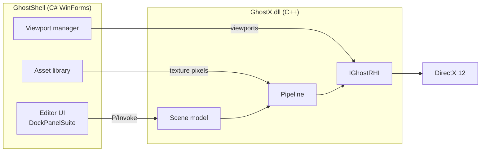

<div align="center">

## Game on Wayne!

# 👻 GhostX Version X 👻💡🧊💡👻

**DirectX12 RHI Renderer Engine Winforms Blazor WASM UI with a Visual Studio Docking Suite Editor**


</div>

GhostX is a custom renderer engine built on a **native C++ DirectX 12 renderer (RHI-style)** with a **C# WinForms editor shell** and a Blazor WASM UI.

## Notes:
- **Working: X64/Release/Debug --- Working: anyCPU Release ---Not working: anyCPU Debug cant find DLL**
- **Does Not Have Standalone Install Shield Wizard Setup Package Yet**
- **If you use this app and the Dock Suite Doesn't show correctly Please delete the XML file in %LocalAppData%\GhostX and your app will run correctly.**
## Development:
- **Does not generate exe yet for Game Builds only outputs DLL to GhostShell.Exe For Play Mode. Phase ?? Is Test Build Publish Exe**
- **When importing FBX meshes please set Largest Side fit to 2 for default normal scaled import.**
---

## Features

- 🎮 **DirectX 12 renderer** behind an RHI interface, so other backends can be added later
- 💡 **Per-pixel lighting:** ambient, directional, point and rect area lights (up to 16)
- 🧊 **Textures:** import PNG/JPG/BMP, per-face materials, six UV mapping modes
- 🎥 **Cameras:** drop up to 4 Free Cameras, each with its own live viewport window
- 🪟 **Dockable editor:** every panel docks, tabs, floats and auto-hides, and the layout is saved
- 🖱️ **Click, drag and drop:** select, move and spawn everything in the viewport
- 🔗 **Native/managed bridge:** a C++ engine DLL driven from C# through P/Invoke
- 🌐 **Blazor WASM UI (experimental):** an optional web UI hosted in WebView2

---
## Roadmap
- **Featured/Assimilated**
- [x] Phase 1: Lighting, viewport icons, click/drag, editor panels
- [x] Phase 2: Textures and materials, Free Camera entities
- [x] Phase 3: Dockable editor, live camera viewports, per-camera resolution
- [x] Phase 4: Project Save/Load/ Load in VS/ Load Game Template/ Basic UI/Play Mode Only/ Object Roles / .ghostproject files / .ghostscene files / Orbit Camera
- [x] Phase 5: UI Editor Designer/ Text And 2D Layer /Widgets/ .ghostui files and the runtime
- [x] Phase 6: Sky Sphere / Custom Mods /Drop and Drag/ Cubemap with 47 Parameters and custom layers
- [x] Phase 7.A: Sprite Sheet Editor Creator / Square
- [x] Phase 7.B: Sprite Sheet Animation Editor / .ghostanim files
- [x] Phase 8: PBR Materials Layout
- [x] Phase 9: Object Shadows
- [x] Phase 10: AnyCPU/X64 Debug/Release Builds/Docking Suite XML Delete to Clear
- [x] Phase 11.A: FBX Imports as Default Color Import. Must Be Set to 2 For Sit Largest Side TO Default for Default Import(2 should be the auto default not 0?)
- [x] Phase 11.B: Saving models, the Models palette and Content Browser tiles.
- [x] Phase 11.C: Materials, collider fit, re-import.
- **Active Core**
- [ ] Phase 12 A: Pre-Building Prep, Level 2 and scene switching 
- [ ] Phase 12 B: Pre-Building Prep, The standalone exe
- [ ] Phase 12 C: Level 1 Build and Test Play / Instructions
- [ ] Phase 12 D: Level 2 Build And Test Play Packaged Exe / Instructions
- **Active SubCore**
- [ ] Phase : UI Features: Origins, XYZ Axis, Selection, Toggle Grids, Toggle Dimensions, Object Selection Rotation/Scale/Transform/Dimension/Translation
- [ ] Phase : Add All Editors Windows Popups to Be able to Reshow if Closed or malfunctioning to docking Suite and Dropdown Windows Selection
- **Publish/Release**
- [ ] Phase : Install Shield Wizard/ Packaged Install for Download
- [ ] Phase : Install Wizard Setup for Standalone Game
- [ ] Phase : RHI Vulkan Backend
- **Pending**
- [ ] Phase : Multi Ext Mesh import gltf, obj etc.. textures, normal/specular maps, shadows, PBR materials
- [ ] Phase : Spot Light / Ray Casting / Global Illumination / Bloom / Subsurface Scattering
- [ ] Phase : Per Instance Shadows
- [ ] Phase : All camera types and features
- [ ] Phase : Antialiasing and options menu
- [ ] Phase : MetaHuman 
- [ ] Phase : Tile Map 
- [ ] Phase : Audio
- [ ] Phase : AutoCad Mesh Integration .step import
- [ ] Phase : Animation Editor/ Bone Hierarchy Editor
- [ ] Phase : Particle Manager
- [ ] Phase : Full Mesh Editor/ Sculpting/Animation/Texture Painting
- [ ] Phase : Packaged Updater
- [ ] Phase : To be added, Experimental

## Rendering Hardware Interface (RHI) Backends
- **Featured**
- [x] DirectX 12 
- **Pending**
- [ ] DirectX 11 
- [ ] Vulkan 
- [ ] OpenGL 
- [ ] Direct X 4
- [ ] DirectX 9


## Editor at a glance

| Panel | What it does |
|---|---|
| **Palette** | Lighting, Primitives and Cameras. Drag an item into the viewport, or double-click to spawn at screen center |
| **Viewport** | The main view. Select, drag and drop, with right-mouse look and WASD |
| **Hierarchy** | Scene Settings, objects, lights and cameras. Double-click a camera to make it the main view |
| **Details** | Properties of the selection: transform, material, light and camera settings. Updates live while you drag |
| **Content Browser** | Texture thumbnails, Import button, drag-and-drop from Explorer |
| **Camera windows** | One live window per dropped camera, floating or docked |

## Controls

| Input | Action |
|---|---|
| Right mouse + move | Look around |
| `W` `A` `S` `D` | Move the active camera |
| `Space` / `Ctrl` | Move up / down |
| Left click | Select an object, light or camera |
| Left drag | Move the selection on a camera-facing plane |
| `Shift` + left click | Pick one face of an object (click again for All Faces) |
| `Delete` | Delete the selection (the last camera can't be deleted) |
| `4` | Hide or show all tool panels |
| Drag a texture tile onto an object | Apply it (hold `Shift` for one face) |
| 'Ctrl + D' | Duplicates Selected Item |
> Camera keys only work while a viewport has focus, so typing in a panel never moves the camera.

## What's New

### 🪟 Docking, camera viewports and resolution
- VS-style docking with **DockPanelSuite**: dock, tab, float, auto-hide and resize every panel
- The layout is saved on exit and restored on launch, with a **Window** menu and **Reset Layout**
- **One swap chain and depth buffer per camera window**, rendered live every frame
- Click a camera window to fly that camera
- **Per-camera resolution** (Match Window, or fixed sizes such as 1280×720 and 1920×1080) rendered offscreen and letterboxed, with picking mapped from window pixels to image pixels

### 🎥 Cameras
- **Free Camera** entities with their own icon and direction arrow
- Position, Yaw, Pitch and FOV in Details, plus a **Main View Camera** switch
- Limit of 4 cameras, and the last camera can never be deleted

### 🧊 Textures and materials
- Import PNG, JPG and BMP from a dialog or by dragging files from Explorer
- Content Browser with thumbnails, and drag a tile onto an object to texture it
- Per-face materials with mapping modes: **Mesh UV, Box, Planar XY/XZ/YZ, Cylindrical, Spherical, Cube Cross**
- Tiling, offset, rotation, wrap, filter and tint
- sRGB textures with generated mip chains, and a resize option that re-uploads at any size up to 4096
- **Shift+click face selection** with a glow highlight

### 💡 Lighting
- Ambient, directional, point and rect area lights, calculated per pixel
- Smooth range falloff, one-sided rect lights, gamma-correct output
- Viewport icons that stay a constant screen size, with hover and selection highlights

### 🌎 Scene and engine
- Backend-agnostic scene model: objects, lights and cameras share one ID space
- Per-object constant buffers (up to 1024 slots), and a mesh registry (Cube, Triangle, Ship)
- Mouse-ray picking with exact ray-triangle tests for faces
- Fixed the mirrored X axis (LookAt handedness, strafe direction, mouse-look yaw)
- The projection uses the real viewport aspect ratio

### ⚙️ Engine API
Exports for objects, lights, cameras, materials, textures, viewports, mouse input and scene versioning, each with a P/Invoke on the C# side.
---

## How To FAQ

- Coming Soon


## Credits

- [DockPanelSuite](https://github.com/dockpanelsuite/dockpanelsuite) (MIT) for the docking UI
- Assimp
---

## Prerequisites

- Windows 10/11 (x64)
- [.NET 10.0 SDK](https://dotnet.microsoft.com/download)
- [Visual Studio 2022+](https://visualstudio.microsoft.com/) with:
  - ASP.NET and web development workload
  - Desktop development with C++ workload
- [WebView2 Runtime](https://developer.microsoft.com/en-us/microsoft-edge/webview2/)
- DirectX 12 compatible GPU
- **NuGet packages (GhostShell):** `DockPanelSuite`, `DockPanelSuite.ThemeVS2015`, `Microsoft.Web.WebView2`, `Assimp`
---
## License

This project is licensed under the **MIT License**.
---

## Blazor WASM Integration Instructions

---
## Architecture


## Project Structure

```
GhostX/
├── GhostX/                        # C++ engine (GhostX.dll)
│   ├── GhostEngine.cpp / .h       # Exported API, camera, picking, input
│   ├── GhostScene.h               # Backend-agnostic scene model
│   ├── GhostPipeline.cpp / .h     # Root signature, PSOs, meshes, textures, offscreen targets
│   ├── GhostRHI_DX12.cpp / .h     # DX12 device, swap chains, surfaces
│   ├── IGhostRHI.h                # RHI interface
│   ├── GhostMath.h                # Vector and matrix math
│   └── shaders/                   # GhostVS.hlsl, GhostPS.hlsl
├── GhostShell/                    # C# WinForms editor
│   ├── GhostForm.cs               # Main window and engine loop
│   ├── GhostEditorUI.cs           # Palette, hierarchy, Details, docking
│   ├── GhostDocking.cs            # Dockable window wrapper, key filter
│   ├── GhostViewports.cs          # Camera windows
│   ├── GhostAssets.cs             # Texture library and thumbnails
│   ├── GhostContentBrowser.cs     # Content Browser panel
│   ├── GhostImageLoader.cs        # Image decoding
│   ├── GhostEngine.cs             # P/Invoke bindings
│   └── GhostMenuBuilder.cs        # Menu bar
└── GhostBlazorUI/                 # Blazor WASM UI (experimental)
```

## Setup & Installation

Follow these steps to integrate the Blazor WASM UI into the WinForms DX12 shell:

### 1. Create Blazor App Inside the Solution

Add a new **Blazor WebAssembly** project to the existing Visual Studio solution alongside the WinForms project.

### 2. Add WebView2 to the WinForms Project

Install the WebView2 NuGet package in the `GhostShell` project:

```
Microsoft.Web.WebView2
```

### 3. Add GhostUIHost.cs to the WinForms Project

Add `GhostUIHost.cs` to `GhostShell` — this class manages WebView2 initialization and points it at the published Blazor output.

### 4. Update Program.cs (WinForms)

Configure the WinForms entry point to start the UI host before launching the application:

```csharp
internal static class Program
{
    [STAThread]
    static void Main()
    {
        GhostUIHost.Start();
        Application.EnableVisualStyles();
        Application.SetCompatibleTextRenderingDefault(false);
        Application.Run(new GhostForm());
    }
}
```

### 5. Update GhostForm.cs

Wire up the WinForms main window to display the WebView2 control and handle layout alongside the DX12 render surface.

### 5A. Update GhostMenuBuilder.cs

Configure the dropdown menu builder to add menu items that communicate with the Blazor UI layer.

### 6. Update index.html in the Blazor Project

Update `wwwroot/index.html` in the Blazor project to configure the base href and ensure compatibility with WebView2 hosting.

### 6A. Check .csproj for Both Projects

Verify both project files are correctly configured:

- **GhostBlazorUI.csproj** — ensure `Microsoft.AspNetCore.Components.WebAssembly` references and target framework are set
- **GhostShell.csproj** — ensure WebView2 package reference is present

### 7. Publish the Blazor Project

```bash
dotnet publish GhostBlazorUI -c Debug
```

### 8. Copy Published Output to WinForms wwwroot

Copy the contents of the Blazor publish output to the WinForms debug bin folder:

```
GhostBlazorUI/bin/Debug/net10.0/publish/wwwroot/
        ↓
GhostShell/bin/Debug/net10.0/wwwroot/
```

### 9. Build and Run

Build the solution in Visual Studio and run `GhostShell`. The WinForms window will launch with the DX12 renderer active and the Blazor UI hosted via WebView2.
---

## Blazor → DX12 Color Bridge

---
Once the base setup is complete, the following wires up live communication between the Blazor UI and the DirectX 12 engine, allowing the Blazor frontend to control the DX12 clear color in real time.

### 1. `index.html` — Add the JS Bridge

Inside the `<head>` tag, before `blazor.webassembly.js`:

```javascript
window.ghostBridge = {
    sendColor: function (colorStr) {
        window.chrome.webview.postMessage("SetColor:" + colorStr);
    }
};
```

### 2. `Home.razor` — Add a Toggle Button

```razor
@inject IJSRuntime JS

<button @onclick="ToggleColor">Toggle BG Color</button>

@code {
    private bool _toggled = false;

    private async Task ToggleColor()
    {
        _toggled = !_toggled;
        await JS.InvokeVoidAsync("ghostBridge.sendColor",
            _toggled ? "0.2,0.0,0.4" : "0.0,0.0,0.0");
    }
}
```

### 3. `GhostForm.cs` — Wire Up the Message Receiver

Inside `OnToggleGhostUI`, after `CoreWebView2.Navigate()`:

```csharp
_ghostUI.CoreWebView2.WebMessageReceived += (sender, args) =>
{
    var msg = args.TryGetWebMessageAsString();
    if (msg.StartsWith("SetColor:"))
    {
        var parts = msg.Replace("SetColor:", "").Split(',');
        float r = float.Parse(parts[0]);
        float g = float.Parse(parts[1]);
        float b = float.Parse(parts[2]);
        GhostEngine.GhostEngine_SetClearColor(r, g, b);
    }
};
```

> **Result:** Clicking the toggle button in the Blazor UI sends a message through WebView2 directly to `GhostEngine_SetClearColor`, changing the DX12 background color in real time.


---

<div align="center">
  <sub>Built by <a href="https://github.com/robert-robot2">robert-robot2</a></sub>
</div>


```
MIT License

Copyright (c) 2026 robert-robot2

Permission is hereby granted, free of charge, to any person obtaining a copy
of this software and associated documentation files (the "Software"), to deal
in the Software without restriction, including without limitation the rights
to use, copy, modify, merge, publish, distribute, sublicense, and/or sell
copies of the Software, and to permit persons to whom the Software is
furnished to do so, subject to the following conditions:

The above copyright notice and this permission notice shall be included in all
copies or substantial portions of the Software.

THE SOFTWARE IS PROVIDED "AS IS", WITHOUT WARRANTY OF ANY KIND, EXPRESS OR
IMPLIED, INCLUDING BUT NOT LIMITED TO THE WARRANTIES OF MERCHANTABILITY,
FITNESS FOR A PARTICULAR PURPOSE AND NONINFRINGEMENT. IN NO EVENT SHALL THE
AUTHORS OR COPYRIGHT HOLDERS BE LIABLE FOR ANY CLAIM, DAMAGES OR OTHER
LIABILITY, WHETHER IN AN ACTION OF CONTRACT, TORT OR OTHERWISE, ARISING FROM,
OUT OF OR IN CONNECTION WITH THE SOFTWARE OR THE USE OR OTHER DEALINGS IN THE
SOFTWARE.
```


